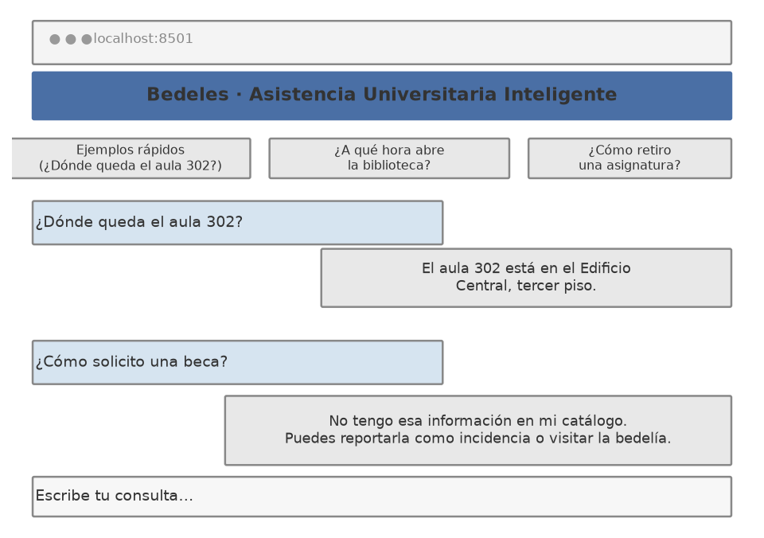
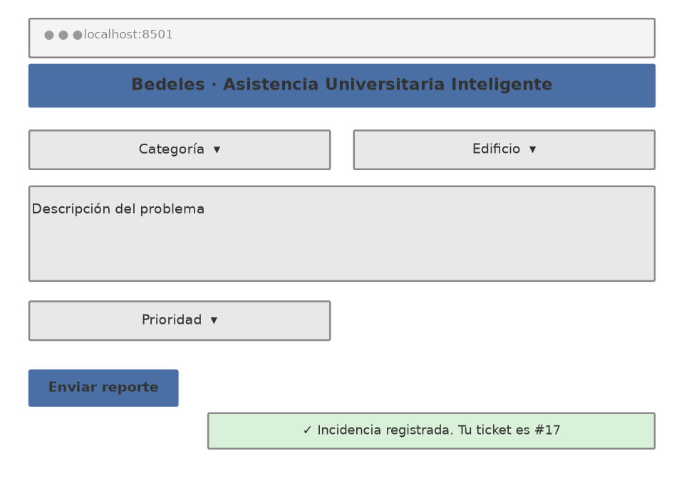
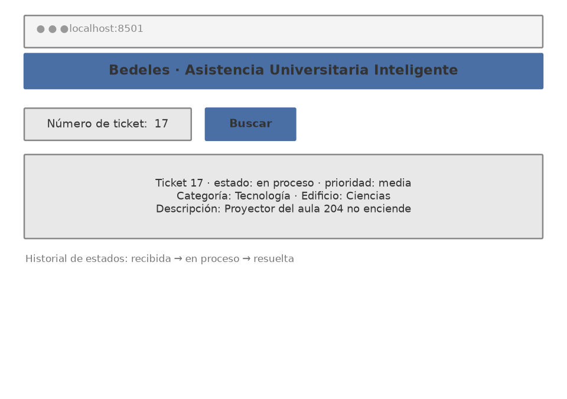
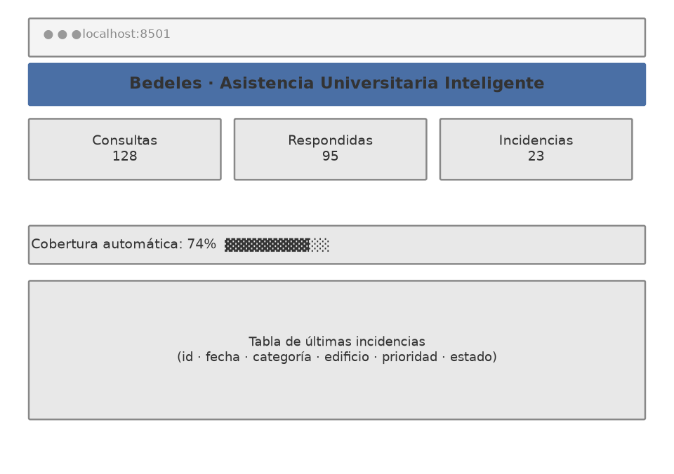

# Diseño conceptual de pantallas (mockups)

Los mockups muestran la guía visual de lo que el MVP implementa: cuatro pantallas, sin funcionalidad en el momento del diseño, que luego se construyeron en Streamlit.

## Pantalla 1 · Asistente de consultas

Flujo: el estudiante escribe su pregunta (o elige un ejemplo rápido). El sistema responde con la FAQ del catálogo más similar. Si la similitud no supera el umbral de confianza, el asistente **se abstiene** y ofrece dos salidas: reportar una incidencia/observación o visitar la bedelía. La abstención con orientación hacia atención humana es parte del diseño, no un fallo.

## Pantalla 2 · Reportar incidencia

Flujo: el usuario selecciona categoría y edificio de listas cerradas (para evitar texto libre ambiguo), describe el problema y asigna prioridad. Al enviar, el sistema confirma con un número de ticket.

## Pantalla 3 · Consultar estado

Flujo: con el número de ticket, el usuario ve categoría, edificio, descripción, prioridad y estado. En el MVP el estado registrado es el inicial (recibida); las transiciones en proceso/resuelta son parte del diseño para el piloto. Esto ataca directamente la frustración "no sé qué pasó con mi solicitud" detectada en el Value Proposition Canvas v1.

## Pantalla 4 · Panel de métricas

Flujo: personal administrativo ve consultas totales, consultas respondidas por el catálogo, incidencias registradas y la cobertura automática. Es la respuesta al problema "falta de trazabilidad y métricas" del planteamiento del problema.
