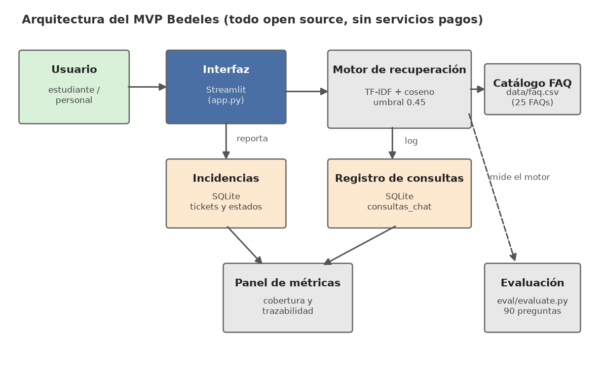

# Diseño de solución

## Arquitectura

Componentes y su correlación:

1. **Interfaz (Streamlit, `app.py`):** cuatro pestañas (asistente, reporte, estado, panel). Es la capa que ve el usuario en la demo.
2. **Motor de recuperación (`src/retriever.py`):** TF-IDF sobre n-gramas de caracteres (2-3) + similitud coseno sobre las 25 FAQs del catálogo. Tolerante a errores de escritura y a variaciones coloquiales, sin necesidad de entrenamiento previo ni GPU. Incluye **umbral de abstención** (0.45): si ninguna FAQ alcanza la similitud mínima, el asistente reconoce que no sabe y deriva a una persona.
3. **Gestión de incidencias (`src/incidencias.py`):** SQLite local con dos tablas: `incidencias` (tickets con categoría, edificio, prioridad y estado) y `consultas_chat` (registro de cada consulta para el panel de métricas).
4. **Base de conocimiento (`data/faq.csv`):** catálogo editable por el personal universitario; ampliar el asistente solo requiere agregar filas al CSV, sin tocar código.
5. **Evaluación (`eval/evaluate.py`):** script que mide el desempeño sobre el conjunto etiquetado y genera las métricas por subgrupo del informe.

## Tecnologías empleadas

| Tecnología | Rol | Razón de la elección |
|---|---|---|
| Python 3.14.3 (probado) | Lenguaje base | Conocido por el equipo, ecosistema de datos |
| Streamlit | Interfaz de demo | Demo web en minutos, ideal para MVP académico |
| scikit-learn | Recuperación TF-IDF | Sin costo, sin API keys, reproducible |
| pandas | Carga de catálogo y evaluación | Estándar para manipulación de datos |
| SQLite | Incidencias y log de consultas | Base de datos embebida, sin servidor |
| Git + GitHub | Control de versiones y entrega | Requisito de la asignación |

## Servicios externos y presupuesto

**Fase MVP (demo académica):** esta implementación no hace llamadas a servicios pagados (la recuperación corre local); el código y la demo pueden alojarse en planes gratuitos.

| Servicio | Uso | Costo |
|---|---|---|
| GitHub (plan gratuito) | Repositorio del código | USD 0 |
| Streamlit Community Cloud | Alojamiento de la demo (opcional) | USD 0 |
| Ejecución local (`streamlit run app.py`) | Alternativa a la nube | USD 0 |

**Fase piloto con una universidad — estimación (hipótesis a validar, precios no verificados):**

| Concepto | Estimado mensual | Supuesto |
|---|---|---|
| VPS pequeño (2 vCPU, 4 GB RAM) | USD 12–20 | 1 campus, < 10.000 consultas/mes |
| Dominio .do o .com | ~USD 1/mes | Costo anual prorrateado |
| Mantenimiento (horas de soporte) | A definir | Depende del SLA acordado |

El MVP no incurre en costos de servicios de IA en la nube: la recuperación TF-IDF corre en el mismo servidor. Si en una fase futura se sustituye por un LLM, el costo variable por consulta habría que estimarse con precios vigentes y validarlo en el piloto. Los montos del piloto son supuestos explícitos, no mediciones.
